# Arquitetura

Aqui estão as decisões que tomamos ao construir o serviço: o que cada uma garante, onde essa garantia é aplicada, o que trocamos por ela e o que ficou de fora. A especificação original está no [`CHALLENGE.md`](./CHALLENGE.md). Se a ideia é subir o projeto ou ver exemplos de requisição e resposta, o melhor ponto de partida é o [`README.md`](./README.md).

## Índice

1. [Visão geral](#visão-geral)
2. [Diagramas](#diagramas): C4, classes, entidade-relacionamento, máquinas de estado e sequência
3. [ORM e acesso a dados](#orm-e-acesso-a-dados)
4. [Mapeamento do `Money`](#mapeamento-do-money)
5. [Garantias no schema](#garantias-no-schema)
6. [Estratégia transacional e de concorrência](#estratégia-transacional-e-de-concorrência)
7. [Idempotência e algoritmo do `payloadHash`](#idempotência-e-algoritmo-do-payloadhash)
8. [Regras de negócio e interpretações](#regras-de-negócio-e-interpretações)
9. [Referências fora de ordem (`PENDING_REFERENCE`)](#referências-fora-de-ordem-pending_reference)
10. [Taxonomia de `failureCode`](#taxonomia-de-failurecode)
11. [Mapeamento de status HTTP](#mapeamento-de-status-http)
12. [Consumidor SQS](#consumidor-sqs)
13. [Transactional Outbox](#transactional-outbox)
14. [Ledger: partidas dobradas, cursor e reconciliação](#ledger-partidas-dobradas-cursor-e-reconciliação)
15. [Observabilidade](#observabilidade)
16. [Autenticação](#autenticação)
17. [Estratégia de testes](#estratégia-de-testes)
18. [Trade-offs e limitações](#trade-offs-e-limitações)

---

## Visão geral

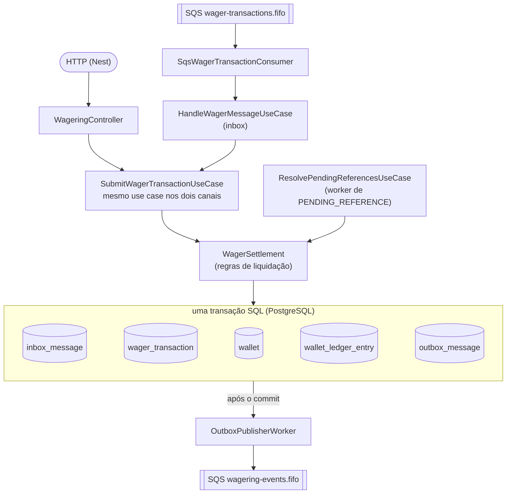

O código está dividido em quatro camadas.

O `domain/` tem só objetos puros, sem NestJS, decorators ou tipos do ORM. Cada classe tem construtor privado e é criada por factories (`create`, `open`, `from`, `rehydrate`); a `rehydrate` reconstrói o que veio do banco sem revalidar transições. É ali que moram as invariantes. O `Money` é imutável, a `Wallet` nunca fica negativa e gera um lançamento para cada alteração de saldo, a `WagerTransaction` tem transições explícitas e estados terminais, e o `WalletLedgerEntry` é imutável por construção.

O `application/` reúne os use cases e as portas (`UnitOfWork`, `Clock`, `IdGenerator`, `EventPublisher`, `Metrics`, `Tracer`). Nada ali depende do Nest: quem instancia tudo, por factories, é o `CoreModule`.

O `infrastructure/` implementa essas portas (MikroORM e PostgreSQL, SQS, Prometheus, OpenTelemetry) e abriga os workers e a observabilidade. Por fim, o `http/` tem os controllers, os DTOs com a validação manual do contrato, um filtro único de erros, a autenticação, feita por um guard JWT, e a documentação OpenAPI.

A documentação da API é gerada pelo `@nestjs/swagger` a partir de decorators nos controllers e publicada em `/docs` (com o JSON em `/docs-json`), só nos processos que servem rotas de negócio. Como os DTOs são interfaces com validação manual, e não classes decoradas, o Swagger não tem como inferir os formatos sozinho; por isso os schemas ficam escritos à mão em `http/openapi/schemas.ts`, ao lado do contrato que descrevem. Um teste confere que todas as rotas estão documentadas, com a autenticação e os status certos, e que toda referência entre schemas aponta para algo que existe. As rotas do Swagger são registradas direto no Express, então ficam abertas, sem passar pelo guard, e também ficam fora do tracing.

### Papéis e imagens

A aplicação roda em três papéis. Cada um tem ponto de entrada, módulo Nest e imagem Docker próprios, todos saídos do mesmo `Dockerfile` multi-stage:

| Papel | Entrada | Módulo | Imagem | O que roda |
|---|---|---|---|---|
| API | `src/main-api.ts` | `ApiModule` | `wagering-api` | `WalletsController`, `WageringController`, guard JWT |
| Consumidor | `src/main-consumer.ts` | `ConsumerModule` | `wagering-consumer` | `WagerTransactionConsumerService` (fila de transações, retry, DLQ) |
| Workers | `src/main-workers.ts` | `WorkersModule` | `wagering-workers` | `OutboxPublisherWorker`, `PendingReferenceWorker`, `RetentionWorker` |

Os três importam o `CoreModule`, que traz PostgreSQL, SQS, relógio, geração de ids, métricas e use cases, e o `OpsModule`, com `/health/*`, `/metrics`, o filtro de erros e o correlation id. O consumidor e os workers só sobem HTTP para atender os probes e expor as métricas. Para desenvolvimento e testes existe ainda o `AppModule` (`src/main.ts`), que junta os três papéis num processo só.

Separar os papéis deixa cada um escalar conforme a própria carga: as réplicas de `api` acompanham o tráfego HTTP, as de `consumer` o backlog da fila e as de `workers` o lag da outbox. Também isola falhas, porque um pico de HTTP não atrasa o consumo da fila, e vice-versa. A correção, por outro lado, não depende dessa separação. Não existe líder nem estado compartilhado em memória; toda a coordenação entre réplicas, de qualquer papel, passa pelo PostgreSQL, com locks de linha, constraints e `SKIP LOCKED`.

## Diagramas

Os diagramas estão em [Mermaid](https://mermaid.js.org/), que o GitHub renderiza direto na página.

### C4 — Contexto

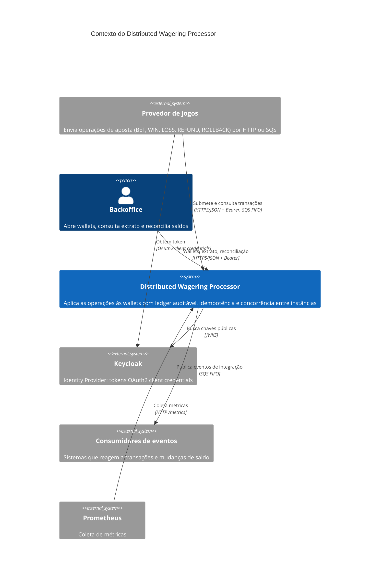

### C4 — Containers

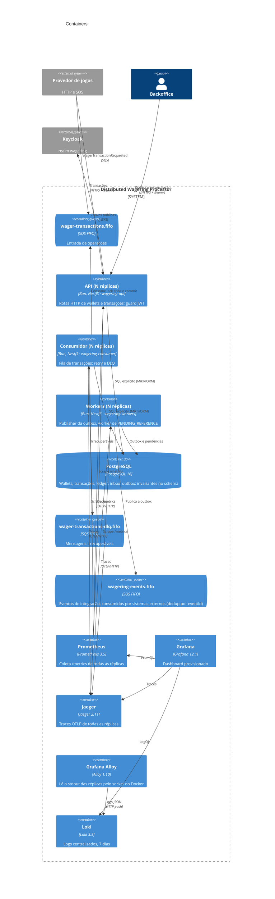

### C4 — Componentes da aplicação

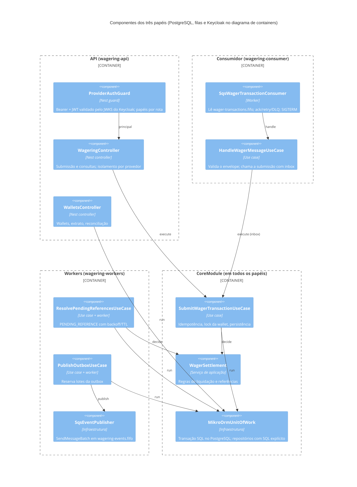

### Classes — domínio

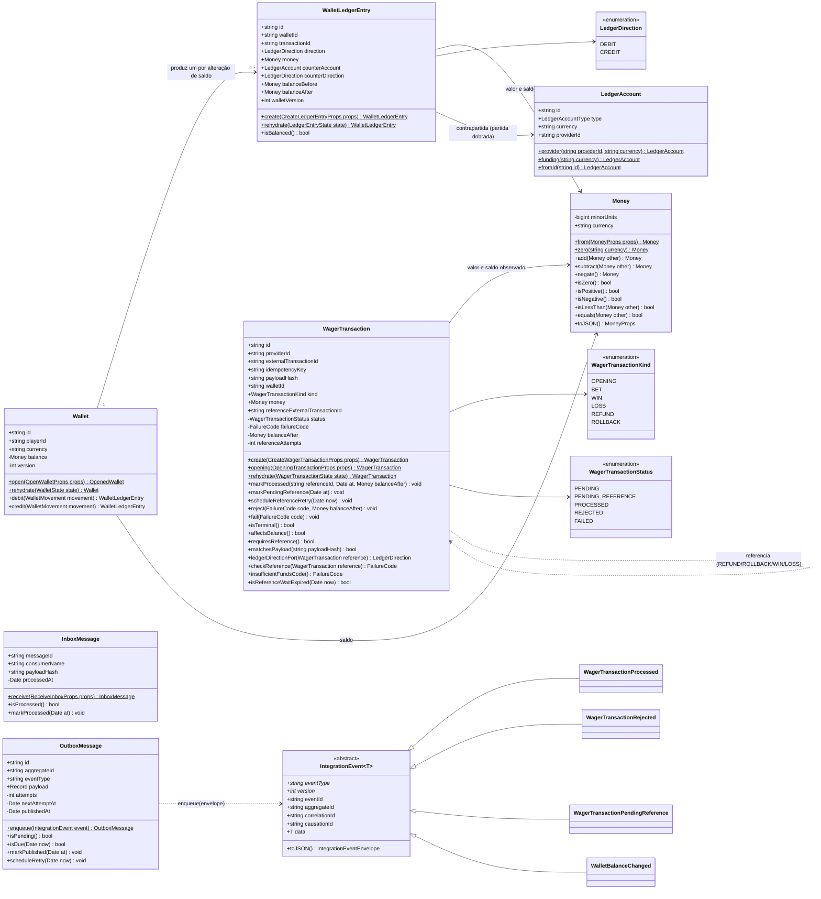

### Classes — aplicação, portas e infraestrutura

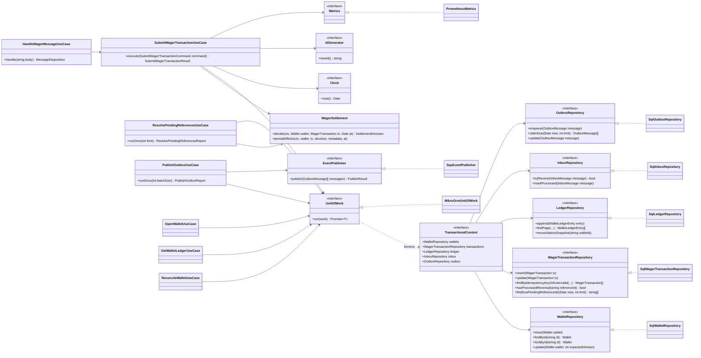

### Entidade-relacionamento (banco de dados)

Valores monetários são `numeric(20,2)`; moedas `char(3)`; instantes `timestamptz(3)`. As constraints estão detalhadas em [Garantias no schema](#garantias-no-schema).

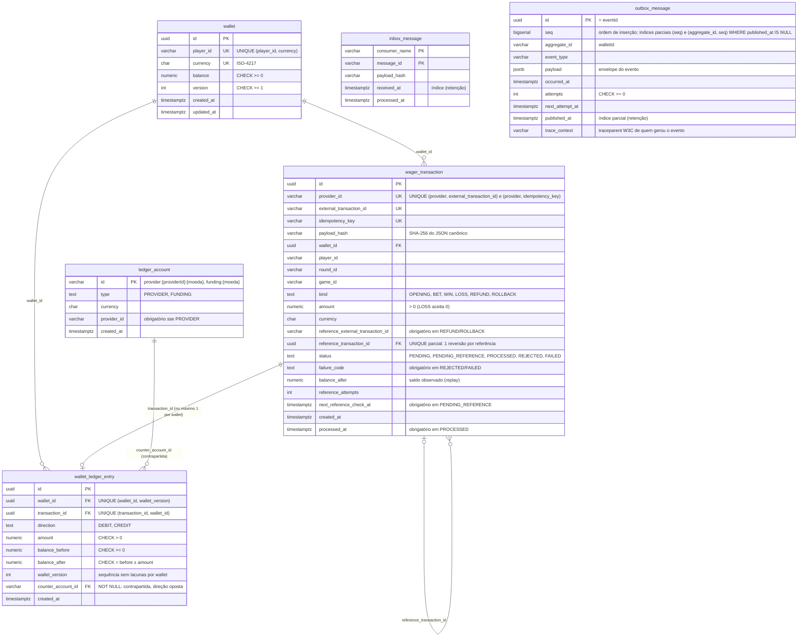

`wallet_ledger_entry` é append-only (triggers bloqueiam `UPDATE`, `DELETE` e `TRUNCATE`); `ledger_account` é imutável; `wager_transaction` não aceita `DELETE`, alteração de campos de negócio nem transição a partir de estado terminal (trigger).

### Máquina de estados — `WagerTransaction`

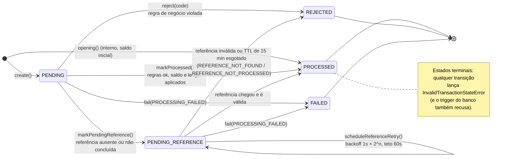

### Máquina de estados — `OutboxMessage`

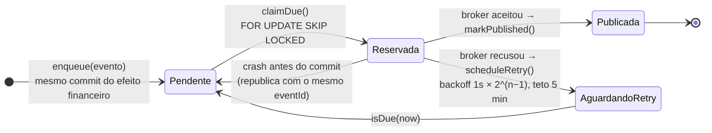

### Máquina de estados — mensagem SQS no consumidor

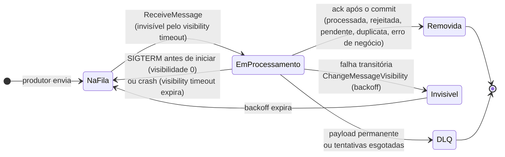

### Sequência — submissão HTTP autenticada (`BET`)

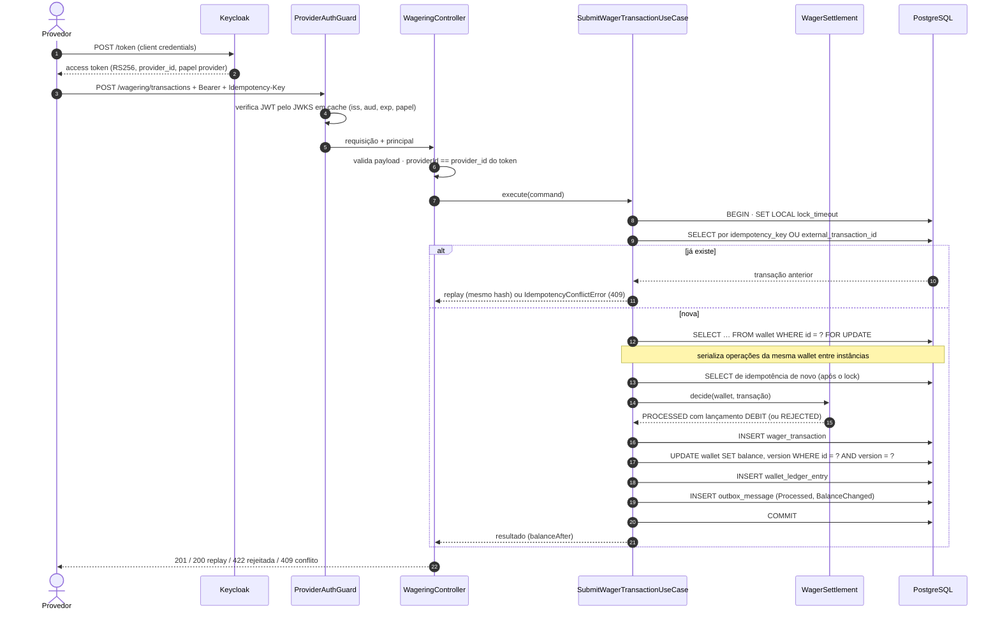

### Sequência — consumo SQS com inbox

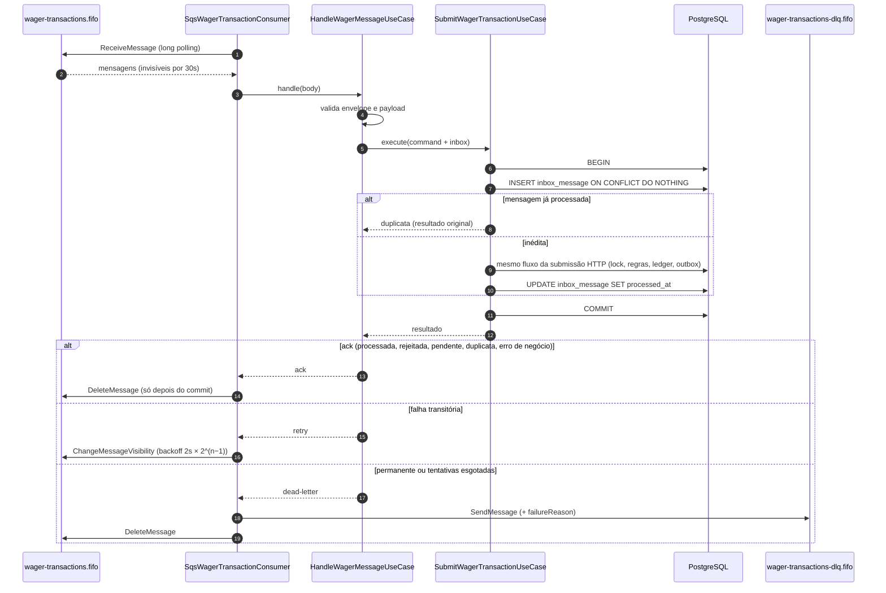

### Sequência — publicação da outbox

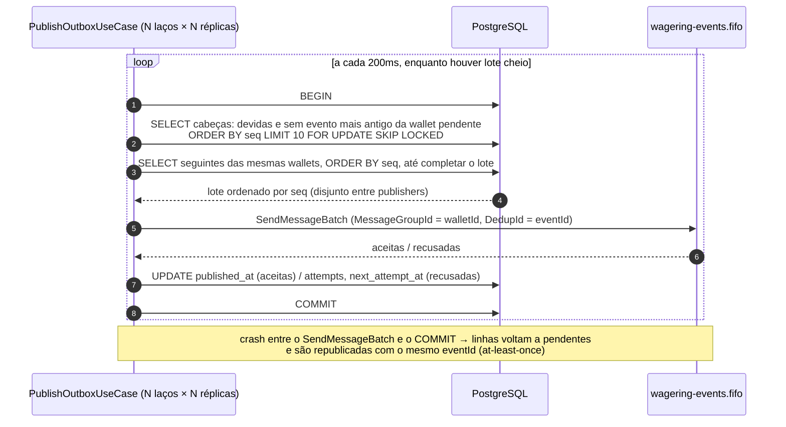

### Sequência — referência fora de ordem (`REFUND` antes da `BET`)

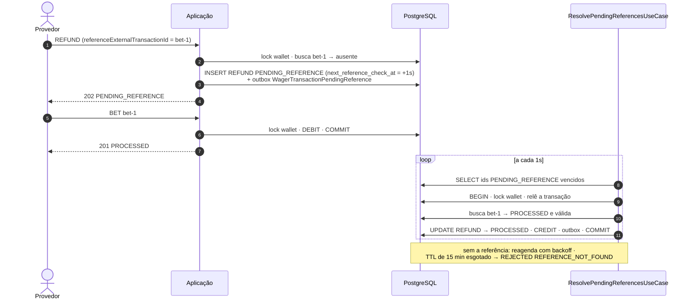

## ORM e acesso a dados

Escolhemos o **MikroORM 7**, que é a opção preferencial do desafio. Pesaram a favor o controle explícito de transação (`em.transactional`) e o suporte declarativo a constraints, índices parciais e triggers.

As entities são a fonte do schema. Elas usam decorators (`@mikro-orm/decorators/legacy`) para declarar colunas, `@Unique`, `@Index` (inclusive parciais, com `where`), `@Check`, chaves estrangeiras (`@ManyToOne({ mapToPk: true })`) e `@Trigger`. As migrations saem do CLI (`migration:create`), a partir do diff entre as entities e o banco, e o teste de schema exige que `getUpdateSchemaSQL()` volte vazio, ou seja, que entities e banco não tenham divergido.

Hoje existem cinco migrations:

- `…_initial_schema` é a migration inicial consolidada, gerada pelo `migration:create` contra um banco vazio. O único trecho escrito à mão é o trigger de `TRUNCATE` do ledger, porque a introspecção do MikroORM não enxerga triggers de TRUNCATE e o recriaria a cada diff. Para conferir a consolidação, comparamos o `pg_dump --schema-only` do banco gerado por ela com o do banco gerado pelas migrations antigas: o conteúdo é o mesmo, e só mudou a posição da coluna `wallet_ledger_entry.wallet_version`.
- `…_double_entry_ledger` cria as contas de contrapartida (`ledger_account`) e a coluna `counter_account_id` no ledger. Aqui também houve trabalho manual: a coluna entra anulável, recebe o backfill dos lançamentos que já existiam (aporte na abertura, provedor nas demais, com o trigger append-only desligado só durante o `UPDATE`) e só depois vira `NOT NULL`, junto com a FK.
- `…_outbox_order_and_retention` adiciona o `seq` da outbox, com backfill na ordem em que as mensagens eram reservadas antes, e os índices de ordem e de retenção.
- `…_outbox_trace_context` adiciona a coluna `trace_context` à outbox.
- `…_transaction_trace_context` adiciona a coluna `trace_context` a `wager_transaction`, para que a resolução de uma pendência continue o trace da requisição original.

Mudanças futuras de schema entram como migrations novas, geradas pelo CLI. Se uma coluna nova precisar ser preenchida em linhas que já existem numa tabela protegida por trigger, o backfill desliga o trigger só durante o `UPDATE`, dentro da própria transação da migration. Todas as migrations têm `down`, e o teste roda `down` até o início e `up` de novo para provar que são reversíveis.

Para ler e gravar dados, usamos SQL explícito executado pelo próprio MikroORM. Os repositórios chamam `em.execute(sql, params)` dentro de `em.transactional` e hidratam as leituras com `em.map(Entity, row)`, que converte os tipos a partir dos metadados dos decorators. O Unit of Work e o flush automático **não** são usados. A vantagem é que toda escrita financeira fica visível no código: `SELECT … FOR UPDATE`, `UPDATE … WHERE version = ?`, `INSERT … ON CONFLICT DO NOTHING`, `FOR UPDATE SKIP LOCKED`.

O CLI roda pelo runtime do Bun (`bun --bun node_modules/.bin/mikro-orm … --config ./src/mikro-orm.config.ts`), que carrega o arquivo de configuração em TypeScript direto, sem precisar do ts-node.

## Mapeamento do `Money`

No domínio, o valor é um `bigint` em unidades mínimas (centavos). A aritmética é exata e não aparece `number` em nenhum ponto do caminho do dinheiro.

Nos contratos, o valor é uma string decimal com escala fixa de 2 casas, como em `{ "amount": "25.00", "currency": "BRL" }`. A entrada aceita `"25"` e `"25.5"`, que viram `"25.00"` e `"25.50"`. Não há arredondamento implícito: rejeitamos `NaN`, `Infinity`, notação científica, string vazia, valores com mais de 2 casas, negativos, sinal `+`, zeros à esquerda e `amount` que não seja string. Excesso de casas é erro, nunca arredondamento.

No banco, o valor fica em `numeric(20,2)`, que o PostgreSQL devolve como string, e a moeda numa coluna `char(3)` separada, com check de formato ISO-4217.

O modelo é multi-moeda. Operar com moedas diferentes lança `CurrencyMismatchError`, e cada `playerId` tem no máximo uma wallet por moeda. O ledger não guarda a moeda, porque ela é sempre a da wallet; assim, um lançamento em moeda divergente simplesmente não tem como existir. Os repositórios reidratam cada lançamento com a moeda da wallet.

## Garantias no schema

O desafio pede que as garantias de unicidade, imutabilidade e não negatividade estejam no banco, e não só no código. A tabela mostra onde cada uma está no PostgreSQL:

| Garantia | Mecanismo no PostgreSQL |
|---|---|
| Uma wallet por `playerId + currency` | `UNIQUE (player_id, currency)` |
| Saldo nunca negativo | `CHECK (balance >= 0)` em `wallet` e nos saldos de cada lançamento |
| Idempotência | `UNIQUE (provider_id, idempotency_key)` e `UNIQUE (provider_id, external_transaction_id)` |
| Uma abertura por wallet | a `OPENING` tem `external_transaction_id = 'opening:{walletId}'` (provider `internal`) |
| Reversão única por referência | índice único parcial em `reference_transaction_id WHERE kind IN ('REFUND','ROLLBACK')` |
| No máximo um lançamento por transação por wallet | `UNIQUE (transaction_id, wallet_id)` |
| Sequência do ledger sem repetição | `UNIQUE (wallet_id, wallet_version)` |
| Aritmética do lançamento | `CHECK (balance_after = balance_before ± amount)` conforme `direction`; `amount > 0` |
| Ledger append-only | triggers que bloqueiam `UPDATE`, `DELETE` e `TRUNCATE` |
| Transação imutável | trigger: campos de negócio nunca mudam; estado terminal nunca transiciona; `DELETE` proibido |
| Coerência de status | checks entre `status` e `processed_at`, `failure_code`, `balance_after`, referência resolvida e agendamento de `PENDING_REFERENCE` |
| Coerência de kind | `REFUND`/`ROLLBACK` exigem referência; `BET`/`OPENING` não aceitam; valor 0 só em `LOSS` |
| Taxonomias fechadas | checks de enum para `kind`, `status`, `failure_code` e `direction` |
| Partidas dobradas balanceadas | por construção: cada linha do ledger é uma transferência (valor na conta da wallet com `direction` e na contrapartida com a direção oposta); não há como gravar uma perna sem a outra |
| Contrapartida obrigatória e válida | `counter_account_id NOT NULL` + FK para `ledger_account` |
| Plano de contas coerente | checks: conta `PROVIDER` ⇔ `provider_id`; tipos fechados (`PROVIDER`, `FUNDING`); contas imutáveis |
| Deduplicação da inbox | `PRIMARY KEY (consumer_name, message_id)` |
| Integridade referencial | FKs `ON DELETE RESTRICT` (wallet ← transação ← ledger; transação ← referência; conta de contrapartida ← ledger) |

## Estratégia transacional e de concorrência

A unidade de concorrência é o `walletId`, e não existe nenhum lock global entre wallets.

O `SubmitWagerTransactionUseCase` faz tudo numa única transação SQL, em READ COMMITTED, nesta ordem:

1. Na entrada por SQS, registra a mensagem na inbox com `INSERT … ON CONFLICT DO NOTHING` em `(consumer_name, message_id)`. Se a mesma mensagem chegar duas vezes ao mesmo tempo, a segunda entrega espera no índice único e, quando a primeira faz commit, é reconhecida como duplicata.
2. Verifica a idempotência antes de pegar o lock, para que um replay não dispute a wallet com operações novas.
3. Trava a wallet com `SELECT … FOR UPDATE`. Isso serializa as operações da mesma wallet entre todas as instâncias, enquanto wallets diferentes seguem em paralelo. O `SET LOCAL lock_timeout` (5s por padrão) transforma uma wallet disputada demais em erro transitório (503 ou retry), em vez de deixar conexões do pool presas esperando.
4. Verifica a idempotência de novo, agora com o lock, porque uma requisição idêntica pode ter feito commit enquanto esta esperava.
5. Deixa o `WagerSettlement` decidir, com as regras do domínio, e grava o resultado: a transação já no estado final, o saldo com `UPDATE wallet … WHERE id = ? AND version = ?` (uma defesa a mais, além do lock), o lançamento no ledger e os eventos na outbox.

Optamos por lock pessimista porque o cenário que mais importa é justamente o da wallet muito disputada, como o 100/80/80 ou várias apostas chegando juntas. Com lock otimista, sob contenção, os retries limitados podem se esgotar e devolver falha para operações válidas. O lock de linha serializa sem desperdício, e a atualização condicionada à `version` continua lá como verificação adicional. Não existe `read → calculate → update` sem controle, porque a leitura usada no cálculo é feita sob lock.

A garantia final, de qualquer forma, é a unicidade no banco. Se outra instância inserir a mesma transação (ou a mesma reversão) entre a verificação e o `INSERT`, a violação de `UNIQUE` desfaz tudo e a operação é repetida uma vez, virando replay ou `REFERENCE_ALREADY_REVERSED`.

Vale registrar uma corrida que os próprios testes encontraram. A primeira versão buscava a transação pela chave de idempotência e depois pelo `externalTransactionId`, em dois `SELECT`s separados. Em READ COMMITTED cada instrução enxerga um snapshot diferente, e um commit concorrente entre as duas buscas fazia uma requisição idêntica parecer conflito. Hoje é uma consulta só (`idempotency_key = ? OR external_transaction_id = ?`), e o teste de 50 apostas idênticas em paralelo cobre esse caso.

Quanto à atomicidade, inbox, transação, saldo, ledger e outbox entram no mesmo commit. Um teste injeta uma falha depois de todos os `INSERT`s e antes do commit e confirma que nenhuma linha sobra em nenhuma tabela.

## Idempotência e algoritmo do `payloadHash`

A fonte da verdade é o header `Idempotency-Key`, que é obrigatório. Recomendamos o formato `{providerId}:{externalTransactionId}`. A unicidade vale por provedor, `(provider_id, idempotency_key)`, para que dois provedores nunca colidam.

O `payloadHash` é o SHA-256, em hexadecimal, do **JSON canônico** dos campos de negócio. Entram `providerId`, `externalTransactionId`, `playerId`, `walletId`, `roundId`, `gameId`, `kind`, `money` e, quando houver, `referenceExternalTransactionId`. Por "canônico" entenda chaves ordenadas recursivamente, sem espaços e sem os campos `undefined`. O `money` entra já normalizado pelo `Money`, então `"25"` e `"25.00"` geram o mesmo hash. O header e os metadados de transporte (`messageId`, `correlationId`, `occurredAt`) ficam de fora.

Mesma chave com o mesmo hash é replay, e a resposta é o **resultado original**, com `idempotentReplay: true`. O saldo devolvido é o daquele momento, guardado em `wager_transaction.balance_after`, e não o saldo atual. Se a operação original foi rejeitada, o replay devolve a mesma rejeição.

Mesma chave com hash diferente, ou o mesmo `externalTransactionId` com outra chave, é conflito: `409 IDEMPOTENCY_CONFLICT`, e não replay.

Na entrada por SQS há ainda a inbox, que deduplica por `(consumerName, messageId)` na mesma transação. Uma mensagem nova (com outro `messageId`) que traga uma chave já usada passa pela inbox e vira replay pela idempotência.

## Regras de negócio e interpretações

| Operação | Saldo | Ledger |
|---|---|---|
| `BET` | débito | 1 `DEBIT` |
| `WIN` | crédito | 1 `CREDIT` |
| `LOSS` | nenhum | nenhum |
| `REFUND` | crédito | 1 `CREDIT` |
| `ROLLBACK` | inverso da referência | 1 lançamento invertido |
| `OPENING` (interno) | crédito do saldo inicial | 1 `CREDIT` |

Onde o texto do desafio deixava margem, adotamos estas interpretações:

1. **Uma única reversão por referência, qualquer que seja o kind.** O desafio diz que uma referência "não pode ser revertida duas vezes pelo mesmo tipo de operação". Ao pé da letra, isso permitiria um `REFUND` e um `ROLLBACK` da mesma `BET`, ou seja, crédito em dobro. Ficamos com a regra estrita: no máximo **uma** reversão `PROCESSED` por referência, garantida por um índice único parcial. Um `ROLLBACK` de `REFUND` continua permitido, porque ele reverte o `REFUND`, e não a `BET`.
2. **`WIN` e `LOSS` podem referenciar a `BET`.** Quando informada, a referência precisa ser uma `BET` `PROCESSED` da mesma rodada. Se ela ainda não chegou, a transação também fica em `PENDING_REFERENCE`.
3. **O que se exige da referência:** mesmo provider, player, wallet, moeda e rodada, status `PROCESSED` e, nas reversões, o mesmo valor, já que não existe reversão parcial.
4. **`LOSS` aceita `0.00`.** Todos os outros kinds exigem valor positivo.
5. **`OPENING` é interno.** A API e a fila o tratam como payload inválido. A transação de abertura já nasce `PROCESSED`, na mesma transação SQL que cria a wallet, e gera `WalletBalanceChanged`.
6. **Wallet inexistente não vira registro.** A FK impede gravar uma transação sem wallet. Pelo HTTP a resposta é `404 WALLET_NOT_FOUND`; pela fila, a mensagem recebe ack como erro de negócio.
7. **Rejeições ficam registradas** como `REJECTED`, com o `failureCode` e o saldo observado. Não geram lançamento, mas geram `WagerTransactionRejected`.

## Referências fora de ordem (`PENDING_REFERENCE`)

Quando a referência não existe ou ainda não foi concluída, a transação fica em `PENDING_REFERENCE`, o evento `WagerTransactionPendingReference` é gerado e o HTTP responde `202`.

Quem resolve essas pendências é um worker (`ResolvePendingReferencesUseCase`) que roda a cada segundo e seleciona, por um índice parcial, as transações com `next_reference_check_at` vencido. Cada item roda na própria transação SQL: o worker trava a wallet, relê a transação e decide com o mesmo `WagerSettlement` da submissão. Se duas instâncias pegarem o mesmo item, a segunda espera o lock, vê que ele já foi resolvido e segue adiante.

A primeira verificação acontece 1s depois; as seguintes seguem 1s × 2^tentativas, com teto de **60s**. Há também um TTL de 15 minutos a partir da criação. A lógica é que reentregas fora de ordem costumam se resolver em segundos, e minutos de espera indicam que a referência provavelmente nunca virá. Quando o TTL acaba, a transação vira `REJECTED` com `REFERENCE_NOT_FOUND` (ou `REFERENCE_NOT_PROCESSED`, se a referência existe mas nunca foi concluída), e o evento correspondente é publicado.

Cadeias também funcionam: um `ROLLBACK` de um `REFUND` que ainda espera a `BET` se resolve em ciclos sucessivos do worker.

## Taxonomia de `failureCode`

Os códigos são contrato público, usados na API, nos eventos e no banco. Por isso nunca são renomeados, só acrescentados. A categoria determina o status: `REJECTED` para regra de negócio e `FAILED` para erro permanente de infraestrutura.

| Código | Categoria | Quando | O que o provedor deve fazer |
|---|---|---|---|
| `INSUFFICIENT_FUNDS` | rejeição | `BET` maior que o saldo | nova operação depois de um crédito |
| `REVERSAL_INSUFFICIENT_FUNDS` | rejeição | reversão que deixaria o saldo negativo (ex.: `ROLLBACK` de um `WIN` já consumido) | escalar; exige conciliação manual |
| `CURRENCY_MISMATCH` | rejeição | moeda da operação ≠ moeda da wallet | corrigir |
| `WALLET_NOT_FOUND` | rejeição | wallet inexistente (fila; no HTTP é 404) | corrigir |
| `WALLET_PLAYER_MISMATCH` | rejeição | a wallet não pertence ao `playerId` | corrigir |
| `REFERENCE_NOT_FOUND` | rejeição | TTL de `PENDING_REFERENCE` esgotado | desistir |
| `REFERENCE_MISMATCH` | rejeição | referência de outro provider, player, wallet, moeda ou rodada | corrigir |
| `REFERENCE_KIND_NOT_ALLOWED` | rejeição | kind da referência não pode ser alvo (ex.: `REFUND` de `WIN`) | corrigir |
| `REFERENCE_NOT_PROCESSED` | rejeição | referência existe mas não está `PROCESSED` | desistir |
| `REFERENCE_ALREADY_REVERSED` | rejeição | referência já revertida | desistir |
| `REVERSAL_AMOUNT_MISMATCH` | rejeição | valor da reversão ≠ valor da referência | corrigir |
| `PROCESSING_FAILED` | falha | erro permanente de infraestrutura | escalar |

`INSUFFICIENT_FUNDS` e `REVERSAL_INSUFFICIENT_FUNDS` são separados de propósito. O primeiro é rotina; o segundo aponta um problema operacional. Quem escolhe entre os dois é o domínio (`WagerTransaction.insufficientFundsCode()`).

## Mapeamento de status HTTP

Todos os endpoints usam o mesmo mapeamento, centralizado no `HttpErrorFilter`, e o corpo de erro é sempre `{ "error": { "code", "message" } }`.

| Situação | Status | Código | Reenviar igual? |
|---|---|---|---|
| Payload inválido (contrato, `Money`, kind, UUID, cursor) | 400 | `INVALID_PAYLOAD` | não |
| Recurso inexistente | 404 | `WALLET_NOT_FOUND` / `TRANSACTION_NOT_FOUND` | não |
| Conflito de idempotência | 409 | `IDEMPOTENCY_CONFLICT` | não |
| Wallet duplicada | 409 | `WALLET_ALREADY_EXISTS` | não |
| Rejeição por regra de negócio | 422 | corpo da transação com `failureCode` | não (replay devolve o mesmo 422) |
| Aceite com processamento pendente | 202 | `status: PENDING_REFERENCE` | sim, é seguro (replay) |
| Sem token / token inválido | 401 + `WWW-Authenticate` | `UNAUTHENTICATED` / `INVALID_TOKEN` | com outro token |
| Sem o papel exigido / provedor diferente do token | 403 | `FORBIDDEN` / `PROVIDER_MISMATCH` | não |
| Falha transitória (conexão, deadlock, lock timeout, modificação concorrente) | 503 + `Retry-After` | `SERVICE_UNAVAILABLE` | **sim** |
| Chaves do IdP inacessíveis | 503 + `Retry-After` | `AUTH_UNAVAILABLE` | **sim** |
| Erro inesperado | 500 | `INTERNAL_ERROR` | — |

Nas respostas de sucesso, `201` quer dizer processada agora e `200` é o replay de uma processada. A rejeição de negócio vem como `422` **com o corpo da transação** (`transactionId`, `status`, `failureCode`, `balance`), e não com o corpo de erro, porque a transação existe e pode ser auditada.

## Consumidor SQS

O consumidor de `wager-transactions.fifo` (`SqsWagerTransactionConsumer`) chama o mesmo use case do HTTP e usa a mesma validação de payload (`parseWagerTransactionInput`). O que acontece com cada mensagem depende do resultado:

| Resultado do handler | Ação |
|---|---|
| processada, rejeitada, pendente, replay ou duplicata (inbox) | **ack**, depois do commit |
| erro de negócio sem transação gravada (`IDEMPOTENCY_CONFLICT`, `WALLET_NOT_FOUND`) | **ack** |
| mensagem malformada (JSON, `type`, `messageId`, payload, `OPENING`) | **DLQ** imediata, com `failureReason` |
| qualquer outro erro (banco, lock timeout, deadlock, inesperado) | **retry** com backoff |

O ack só acontece depois do commit, porque o `DeleteMessage` vem depois que o handler retorna. Se o processo morrer entre o commit e o ack, a reentrega é reconhecida pela inbox como duplicata e o efeito não se repete; há um teste para isso.

O retry estende a visibilidade da mensagem, com backoff de 2s × 2^(entrega − 1) e teto de 300s. Depois de `SQS_CONSUMER_MAX_ATTEMPTS` entregas (5), a mensagem vai explicitamente para a DLQ, e a `RedrivePolicy` (`maxReceiveCount` 5) fica como rede de segurança. O envio para a DLQ copia a mensagem primeiro e só depois a remove da fila de entrada, então um crash no meio do caminho deixa no máximo uma cópia extra, sem nunca perder a mensagem.

A ordem FIFO é respeitada: se uma mensagem de um grupo volta para retry, as seguintes do mesmo grupo naquele lote voltam junto. Consumidores paralelos (`SQS_CONSUMER_CONCURRENCY`) recebem grupos diferentes. Mesmo assim, o FIFO é só uma otimização, e quem garante as invariantes é o banco.

No SIGTERM, o consumidor interrompe o long polling, termina a mensagem em andamento e devolve a visibilidade das que ainda não começaram. Consumidores e workers param no `beforeApplicationShutdown`, antes de o pool do PostgreSQL e o cliente SQS serem fechados.

Se a instância morrer de vez, a mensagem que estava em processamento volta para a fila quando a visibilidade expira (`SQS_CONSUMER_VISIBILITY_TIMEOUT_SECONDS`, 30s). Esse é o tempo de recuperação, e no FIFO o grupo inteiro espera por ele.

## Transactional Outbox

Os eventos são gravados em `outbox_message` na mesma transação do efeito financeiro, e o `id` de cada mensagem é o próprio `eventId`.

A publicação fica com o `PublishOutboxUseCase`, que roda a cada 200ms em cada instância, com `OUTBOX_PUBLISHER_CONCURRENCY` laços em paralelo (4 por padrão). Numa transação, ele reserva um lote de até 10 mensagens com `FOR UPDATE SKIP LOCKED`, publica com `SendMessageBatch` e marca as aceitas como publicadas. As recusadas ganham nova tentativa com backoff de 1s × 2^(n−1) e teto de 5 minutos; a outbox **nunca desiste** de uma mensagem. Só então vem o commit.

### Ordem por wallet

A ordem dos eventos de uma wallet é garantida mesmo com vários publishers concorrendo. Cada mensagem recebe um `seq`, que é uma sequência do banco. Como todo evento de uma wallet é gravado enquanto a transação segura o lock dessa wallet, o `seq` segue, por wallet, a ordem dos commits. O `occurred_at` não serviria para isso: ele vem do relógio de cada instância e é lido antes do lock.

A reserva acontece em duas etapas, dentro da mesma transação. Primeiro vêm as "cabeças", isto é, mensagens devidas para as quais não existe nenhuma mensagem mais antiga da mesma wallet ainda pendente (`NOT EXISTS`). Elas são reservadas com `SKIP LOCKED`, no máximo uma por wallet. Depois vêm as mensagens seguintes dessas mesmas wallets, em ordem de `seq`, até completar o lote; ninguém mais consegue reservá-las enquanto a cabeça estiver pendente. Se uma cabeça entra em backoff, ela segura só os eventos seguintes da própria wallet, e as outras wallets continuam andando. O lote sai ordenado por `seq`, e o SQS FIFO preserva a ordem das entradas de um mesmo `MessageGroupId`.

O teste usa 5 publishers concorrentes, com atraso aleatório em cada publicação. Também conferimos que ele falha quando a regra da cabeça é removida.

Os índices parciais seguem a ordem da reserva (`(seq)` e `(aggregate_id, seq)`, com `WHERE published_at IS NULL`), de modo que reservar um lote não fica mais caro à medida que o backlog cresce. Foi o teste de carga que mostrou a importância disso: um índice que não servia à ordenação obrigava o banco a ordenar a fila inteira a cada lote. Com 45 mil pendentes, a reserva caiu de 14,5ms para 0,038ms, e a drenagem depois da carga, de 82s para 0,03s. Os detalhes estão no [`LOAD_TEST.md`](./LOAD_TEST.md).

### Retenção

O `RetentionWorker` roda o `PurgeExpiredMessagesUseCase` a cada `RETENTION_INTERVAL_MS` (60s por padrão). Ele apaga as mensagens da outbox **já publicadas** há mais de `OUTBOX_RETENTION_HOURS` (7 dias por padrão; as pendentes nunca são apagadas) e os registros da inbox recebidos há mais de `INBOX_RETENTION_HOURS` (14 dias por padrão, que é a retenção máxima do SQS). Apaga em lotes de 1.000, em transações curtas e com `SKIP LOCKED`, o que torna seguro rodar em várias instâncias, e registra o volume apagado em `wagering_retention_deleted_total{table}`. Uma reentrega que chegue depois da retenção da inbox não duplica efeito: ela cai na idempotência de `wager_transaction` e vira replay.

### O que a outbox garante

- Nunca publica antes do commit, porque só linhas confirmadas aparecem na reserva. O teste prova isso segurando a transação produtora aberta.
- Não perde eventos, já que uma linha só deixa de ser pendente no mesmo commit que registra a publicação.
- Publishers concorrentes recebem lotes que não se sobrepõem. Testamos com 5 publishers e 60 eventos, e cada evento foi publicado exatamente uma vez.
- Se o processo cair depois de publicar e antes do commit, as linhas voltam a ficar pendentes e são republicadas com o mesmo `eventId` (também testado). É entrega at-least-once: o FIFO descarta a cópia pelo `MessageDeduplicationId`, que é o `eventId`, dentro de 5 minutos, mas **o consumidor precisa deduplicar pelo `eventId`**.

Cada mensagem publicada usa o `walletId` (`aggregateId`) como `MessageGroupId`, leva os atributos `eventType`, `eventId` e `traceparent` (o trace de quem gerou o evento, quando havia um) e tem como corpo o envelope JSON.

Os eventos derivam da classe abstrata `IntegrationEvent<T>`. O `eventType` e a `version` ficam no tipo de cada subclasse, e o `data` carrega `MoneyProps`, nunca `Money`:

| Evento | Quando |
|---|---|
| `WagerTransactionProcessed` | qualquer transação aplicada, inclusive `LOSS` |
| `WagerTransactionRejected` | rejeição de negócio |
| `WalletBalanceChanged` | somente quando o saldo muda, inclusive na abertura; traz `walletVersion` |
| `WagerTransactionPendingReference` | ao entrar em `PENDING_REFERENCE` |

## Ledger: partidas dobradas, cursor e reconciliação

### Partidas dobradas

Cada `wallet_ledger_entry` é, ao mesmo tempo, o lançamento do extrato e a transferência de partidas dobradas da operação. O valor entra na conta da wallet com a `direction` do lançamento e na conta de contrapartida (`counter_account_id`) com a direção oposta. É o modelo de *transfer*, com débito numa conta e crédito em outra pelo mesmo valor, o mesmo que o TigerBeetle usa:

| Operação | Conta da wallet | Contrapartida |
|---|---|---|
| `OPENING` | crédito | débito em `funding:{moeda}` (aporte) |
| `BET` | débito | crédito em `provider:{providerId}:{moeda}` |
| `WIN`, `REFUND` | crédito | débito no provedor |
| `ROLLBACK` | inverso da referência | oposto, no provedor |

A conta da wallet é um passivo do operador: crédito aumenta o saldo e débito diminui. O saldo dela é o próprio `wallet.balance`, que pode ser reconstruído pelo extrato. O balanceamento vem **por construção**, porque as duas pernas estão na mesma linha, com o mesmo valor. Não há tabela de partidas nem verificação no commit, e a regra "toda alteração de saldo tem lançamento, e vice-versa" continua valendo com uma linha só.

A contrapartida é obrigatória tanto no domínio (`WalletMovement.counterAccount`) quanto no schema (`NOT NULL` + FK), e `WalletLedgerEntry.create` recusa contrapartida em outra moeda. `LOSS` e rejeições não geram lançamento, então também não geram nenhuma perna.

As contas de sistema (provedor e aporte) **não** têm saldo materializado: o saldo delas é a soma dos lançamentos em que aparecem como contrapartida. Guardar o saldo do provedor numa linha faria todas as wallets daquele provedor atualizarem essa mesma linha, o que na prática seria um lock global, justamente o que a restrição 6 do desafio proíbe. O balancete fecha assim: a soma dos saldos materializados das wallets mais a soma dos saldos das contas de sistema dá zero. Isso é testado e também verificado no teste de carga.

O modelo tem um limite: lançamentos com três ou mais pernas, como uma aposta com taxa cobrada à parte, não são representáveis. Nenhuma operação do desafio tem mais de duas pontas. Chegamos a implementar e medir a alternativa, uma tabela de partidas com N pernas e triggers diferidos verificando o balanceamento no commit, ainda dentro da seção crítica do lock da wallet. A vazão HTTP do teste de carga caiu cerca de 33%, contra cerca de 20% do modelo atual (os números estão no [`LOAD_TEST.md`](./LOAD_TEST.md)).

### Sequência e cursor do extrato

Cada lançamento guarda a `version` da wallet que ele produziu (a abertura é a 1). Isso forma uma **sequência sem lacunas** por wallet, garantida por `UNIQUE (wallet_id, wallet_version)`.

O `GET /ledger` pagina do mais recente para o mais antigo por essa sequência (keyset). O cursor é o base64url de `{ v }`: opaco para o cliente e estável, porque lançamentos novos nunca deslocam as páginas seguintes. Paginar por `created_at` dependeria do relógio de cada instância.

### Reconciliação

O `POST /reconciliation` lê o saldo armazenado e os totais de crédito e débito do ledger numa **única instrução SQL**, ou seja, num único snapshot, mesmo que a wallet esteja sendo movimentada ao mesmo tempo, e calcula o saldo do ledger com `Money`. Uma divergência é sinalizada na resposta (`consistent: false`, `difference`), contada em `wagering_reconciliations_total{result="divergent"}` e registrada em log (`reconciliation_divergence`). Ela **nunca é corrigida** automaticamente.

## Observabilidade

### Logs

Os logs são JSON estruturado, uma linha por evento (`JsonLogger`). O contexto de cada requisição ou mensagem é propagado por `AsyncLocalStorage`, o que acrescenta `correlationId`, `messageId`, `transactionId`, `walletId` e `providerId` a todos os logs daquela unidade de trabalho. O `X-Correlation-Id` é aceito do cliente (ou gerado), devolvido na resposta e repassado aos eventos da outbox.

Payloads e valores financeiros completos (`payload`, `data`, `money`, `amount`, `balance*`) e credenciais são mascarados; nos logs ficam só identificadores, status e códigos. Os eventos principais são `http_request` (método, rota, status e duração), `wager_transaction`, `sqs_message`, `reconciliation_divergence` e os relatórios dos workers. Com o tracing ligado, cada linha traz também o `traceId` e o `spanId` do span ativo, o que permite ir de um log direto ao trace correspondente.

### Traces

O tracing usa OpenTelemetry e é ligado com `OTEL_ENABLED=true`. No Compose, os traces vão por OTLP/HTTP para o Jaeger. A instrumentação é manual, com o SDK oficial, porque a auto-instrumentação depende de hooks de `require` que não funcionam de forma confiável no Bun.

Estes são os pontos rastreados:

- **HTTP:** um span de servidor por requisição (por exemplo, `POST /wagering/transactions`). Ele continua o `traceparent` enviado pelo cliente e registra rota, status e os mesmos identificadores dos logs (`wagering.correlationId`, `wagering.transactionId`, `wagering.walletId`, `wagering.providerId`). O `traceId` volta no header `x-trace-id`, e `/health/*` e `/metrics` ficam de fora.
- **Banco:** um span `db.transaction` e um span por instrução (`insert wallet_ledger_entry`, `select wallet`…; numa CTE, vale a instrução principal), com o SQL sem valores, só com os placeholders. Esses spans só existem dentro de um trace, então o polling ocioso dos workers não gera nada.
- **SQS:** um span de consumidor por mensagem. Ele continua o trace do produtor quando a mensagem traz o atributo `traceparent` e registra a decisão (`ack`, `retry` ou `dead-letter`).
- **Outbox:** a mensagem guarda o `traceparent` de quem gerou o evento (`trace_context`). O publisher cria um span de produtor por lote, com um link para o trace de cada evento, e também um span por evento (`publish WalletBalanceChanged`, por exemplo) dentro do trace da requisição que o originou, com o `transactionId`, o tipo do evento e a wallet. Cada evento publicado gera ainda uma linha de log (`outbox_event_published`) com o `traceId` dessa requisição. O `traceparent` original segue no atributo da mensagem, então quem consome `wagering-events.fifo` continua o mesmo trace.
- **Workers:** um span para cada referência pendente resolvida e um para cada lote publicado da outbox, emitidos pela porta `Tracer` dos use cases (que vira no-op sem OpenTelemetry). Ciclos sem trabalho não geram span. A transação guarda o `traceparent` de quem a criou (`wager_transaction.trace_context`), e a resolução de uma `PENDING_REFERENCE` continua esse trace, mesmo que aconteça minutos depois.

Além desses pontos de entrada e saída, o trace mostra as camadas internas da aplicação. Cada use case ganha o seu span (`SubmitWagerTransactionUseCase.execute`, `HandleWagerMessageUseCase.handle`, `OpenWalletUseCase.execute` e assim por diante) por um wrapper aplicado no `CoreModule`, de modo que o código dos use cases continua sem saber de tracing. Dentro da transação SQL, a decisão das regras de liquidação aparece como `WagerSettlement.decide` e a gravação dos efeitos como `WagerSettlement.persistEffects`. Uma aposta via HTTP fica assim no Jaeger:

```text
POST /wagering/transactions                    http
└─ SubmitWagerTransactionUseCase.execute        application   status=PROCESSED
   └─ db.transaction                            persistence
      ├─ select wallet                          persistence   (lock da wallet)
      ├─ WagerSettlement.decide                 domain        status=PROCESSED
      ├─ insert wager_transaction               persistence
      └─ WagerSettlement.persistEffects         application   outboxEvents=2
         ├─ update wallet                       persistence
         ├─ insert wallet_ledger_entry          persistence
         └─ insert outbox_message (×2)          persistence
```

Com isso, um único `traceId` conta a história inteira de uma operação. Buscando o trace de uma aposta, aparecem a requisição na API e, logo depois, a publicação dos eventos dela pelo worker. No caso de um `REFUND` que chegou antes da `BET`, o mesmo trace mostra a API registrando a pendência e, mais tarde, o worker resolvendo a transação com as mesmas camadas e publicando os eventos finais. A busca pela tag `wagering.transactionId` leva ao mesmo trace, e no Loki o `traceId` traz as linhas da API e as do worker.

Todo span tem o atributo `wagering.layer` (`http`, `messaging`, `application`, `domain` ou `persistence`), o que permite buscar por camada no Jaeger. Os spans de use case também registram o resultado: kind, status, se foi replay, a decisão sobre a mensagem ou se a reconciliação fechou. Para não gerar ruído, o span de use case só nasce quando já existe um trace em andamento.

A amostragem é decidida na raiz por `OTEL_TRACES_SAMPLER_ARG` (1 por padrão), e os spans filhos seguem o pai. Cada papel tem o seu `service.name`: `wagering-api`, `wagering-consumer` e `wagering-workers`.

### Logs centralizados (Loki)

No Compose, os logs de todas as réplicas vão para o Loki. Quem os leva é o Grafana Alloy, que descobre os containers de `api`, `consumer` e `workers` pelo socket do Docker e lê o stdout de cada um. A aplicação não sabe que o Loki existe e continua só escrevendo JSON no stdout, o que mantém o mesmo comportamento em qualquer ambiente.

No caminho, o Alloy transforma em labels só o que tem poucos valores: o papel (`service`), a réplica (`container`) e o nível (`level`). O `traceId` e o `correlationId` mudam a cada requisição; como labels, criariam um stream por requisição e degradariam o Loki. Por isso eles vão como metadado estruturado, que também pode ser filtrado (`| traceId="..."`). Os logs ficam guardados por 7 dias, em disco local; em produção, o armazenamento iria para um bucket.

### Métricas

As métricas ficam em `GET /metrics`, no formato do Prometheus:

| Métrica | Tipo | Labels |
|---|---|---|
| `wagering_transactions_total` | counter | `channel` (http, sqs, worker), `kind`, `status` |
| `wagering_duplicates_total` | counter | `type` (`idempotent_replay`, `inbox_duplicate`) |
| `wagering_concurrency_conflicts_total` | counter | `reason` (corrida de inserção, lock timeout, deadlock, modificação concorrente) |
| `wagering_processing_duration_seconds` | histogram | `channel` |
| `wagering_message_retries_total` | counter | `source` (`sqs`, `outbox`) |
| `wagering_dead_letters_total` | counter | `reason` (`permanent`, `exhausted`) |
| `wagering_outbox_published_total` | counter | — |
| `wagering_outbox_publish_lag_seconds` | histogram | atraso entre ocorrência e publicação |
| `wagering_outbox_lag_seconds` | gauge | idade do evento pendente mais antigo, lida do banco no scrape (cresce mesmo sem nenhum publisher vivo) |
| `wagering_outbox_pending` | gauge | eventos aguardando publicação |
| `wagering_pending_reference_transactions` | gauge | transações em `PENDING_REFERENCE` |
| `wagering_reconciliations_total` | counter | `result` |
| `wagering_retention_deleted_total` | counter | `table` (`outbox`, `inbox`) |
| métricas padrão do processo | — | — |

No Compose, o Prometheus descobre as réplicas de cada papel pelo DNS (`dns_sd_configs`, com um job por papel: `api`, `consumer` e `workers`) e coleta a cada 5s.

### Tudo no Grafana

O Grafana reúne as três fontes, com os datasources e o dashboard "Wagering — visão geral" provisionados a partir de [`observability/`](./observability). Os datasources estão ligados entre si para que a investigação não pare em nenhuma das três. O Loki tem um campo derivado que transforma o `traceId` de cada linha num link para o trace no Jaeger. O Jaeger, por sua vez, tem um botão em cada span que abre no Loki os logs do mesmo trace. O dashboard junta as métricas do Prometheus e, no fim, uma seção de logs do Loki com o volume por nível e por papel, os avisos e erros e as requisições recentes. No dashboard, os contadores são somados entre as réplicas (`sum`). Já os gauges de backlog vêm do banco, e todas as réplicas reportam o mesmo valor, por isso usamos `max`.

### Health checks

O `GET /health/live` só confirma que o processo responde. O `GET /health/ready` verifica o PostgreSQL (`select 1`) e o SQS (se a fila de entrada existe), cada um com timeout de 2s, e devolve 503 se algum falhar. Nenhum dos dois exige autenticação.

## Autenticação

A autenticação é OAuth2/OIDC, com o **Keycloak** como Identity Provider externo. Não há nada feito à mão: nenhuma tabela de usuários e nenhum hash de senha na aplicação.

O realm `wagering` ([`keycloak/realm-wagering.json`](./keycloak/realm-wagering.json)) é importado quando o Compose sobe. Ele tem um cliente confidencial para cada provedor (`provider-a` e `provider-b`), que usa *client credentials* (service account), com o papel `provider` e a claim fixa `provider_id`. Tem também um cliente `backoffice`, com o papel `operator`. Todos os tokens saem com a audience `wagering-api`, e os segredos que estão no arquivo servem só para desenvolvimento.

A validação fica com o `JwtVerifier`, que usa a biblioteca `jose` para conferir a assinatura RS256 pelo JWKS do IdP, além de `iss`, `aud`, `exp` e `nbf`, com tolerância de 5s. As chaves ficam em cache e são renovadas quando aparece um `kid` desconhecido (rotação de chave). Se o Keycloak cair, tokens assinados com chaves já conhecidas continuam valendo até expirar, o que leva 5 minutos. Se for preciso buscar chaves e o IdP estiver fora, a resposta é `503 AUTH_UNAVAILABLE`, tratada como falha transitória.

O emissor é fixo (`KC_HOSTNAME=http://localhost:8080`), então os tokens têm o mesmo `iss` qualquer que seja o host usado para obtê-los. A aplicação busca as chaves em `AUTH_JWKS_URL`, que dentro do Compose aponta para `keycloak:8080`.

A autorização é feita pelo `ProviderAuthGuard`, um guard global. Rotas marcadas com `@Public()` (health e métricas) passam sem token. As demais exigem `Bearer` (senão, `401`) e o papel declarado com `@RequireRole` (senão, `403 FORBIDDEN`). Wallet, extrato e reconciliação pedem `operator`; as rotas de wagering pedem `provider`.

O isolamento entre provedores fica nos controllers, que são quem conhece o `providerId` da operação. O `POST /wagering/transactions` e a consulta por `providerId` exigem que o `providerId` seja o mesmo do token, senão respondem `403 PROVIDER_MISMATCH`. Já a consulta por id interno de uma transação de outro provedor devolve `404`, sem revelar que ela existe.

A fila SQS é tratada como canal interno confiável e não passa pelo IdP. Mesmo assim, o `providerId` da mensagem continua sujeito às mesmas validações de domínio: referências, idempotência e unicidade são todas por provedor.

`AUTH_ENABLED=false` desliga a verificação. Os testes partem desse padrão e ligam a autenticação só nos testes específicos dela; o teste com várias instâncias e o teste de carga também rodam sem autenticação.

Dois arquivos de teste cobrem a autenticação. O `auth-http.spec.ts` usa um IdP local, com chaves RS256 e JWKS próprios, para testar de forma determinística tokens ausentes, malformados, expirados, assinados por outra chave e com emissor ou audience errados, além dos papéis e do isolamento entre provedores. O `keycloak-auth.spec.ts` faz o fluxo completo com o Keycloak de verdade (client credentials e token adulterado) e é pulado quando o Keycloak não está no ar.

## Estratégia de testes

| Nível | Onde | O que é real |
|---|---|---|
| Unidade | `src/**/*.spec.ts` | domínio puro (Money, Wallet, WagerTransaction, ledger e contas de contrapartida, inbox, outbox, eventos), `payloadHash`, mappers, logger |
| Integração | `test/integration` | **PostgreSQL e SQS (LocalStack) reais**: schema e constraints (inclusive contrapartida obrigatória e plano de contas), migrations (drift e reversibilidade), atomicidade, idempotência, referências, inbox e redelivery, retry e DLQ, SIGTERM, outbox (commit, crash, publishers concorrentes, ordem por wallet), retenção, HTTP, documentação OpenAPI, health, métricas e traces (OpenTelemetry com exporter em memória) |
| Concorrência | `test/integration` e `test/concurrency` | paralelismo real no banco; **3 processos reais da aplicação** |

Os cenários obrigatórios do desafio estão todos cobertos:

- a mesma aposta enviada 50 vezes em paralelo resulta em um único débito, tanto no mesmo processo quanto espalhada por 3 instâncias;
- o cenário 100/80/80, repetido 10 vezes e também com cada aposta numa instância diferente;
- wallets distintas processadas em paralelo;
- 3 instâncias recebendo HTTP e SQS, com reentregas e referências fora de ordem, e uma delas morta por **SIGKILL** no meio da carga enquanto outra sobe no lugar. No fim, cada mensagem foi processada exatamente uma vez, não sobra nenhum `PENDING_REFERENCE`, os saldos batem e a outbox está drenada;
- o worker morto depois do commit e antes do ack;
- dois (e também cinco) publishers sobre a mesma outbox;
- `REFUND` e `ROLLBACK` chegando antes da referência, inclusive em cadeia;
- o encerramento gracioso (SIGTERM) das 3 instâncias;
- os papéis em processos separados (`api`, `consumer` e `workers`), subindo um de cada vez. Sem consumidor a fila não anda, e sem workers a outbox e as pendências também não. O consumidor e os workers respondem 404 nas rotas de negócio, e todos expõem health e métricas.

Todo teste que mexe em saldo termina chamando `expectLedgerConsistent`, que confere `wallet.balance == Σ ledger` e se toda contrapartida está na moeda da wallet. As contas são feitas em `numeric`, no próprio PostgreSQL.

Onde não dá para derrubar o PostgreSQL só para um teste, um `UnitOfWork` decorado simula a falha antes do commit, o "crash" depois de publicar ou a indisponibilidade. Em todo o resto, o SQS e o PostgreSQL são reais. Backoff e TTL usam um relógio controlável (`FakeClock`).

## Trade-offs e limitações

**Transação aberta durante a publicação da outbox.** Isso simplifica e garante a semântica, porque o lote é pequeno e só as linhas reservadas ficam travadas. O preço é que cada laço de publicação segura uma conexão do pool (são 10 por instância) enquanto espera o SQS, o que limita quantos laços cabem. A alternativa seria uma reserva com expiração (lease) numa coluna própria, que tiraria a chamada de rede de dentro da transação, à custa de mais estados para gerenciar.

**Lag da outbox no pico.** No teste de carga, com cerca de 1.000 eventos por segundo, o lag sobe durante o pico e zera assim que a carga cai. Antes da ordem por wallet ele chegava a uns 13s; na execução mais recente, o p99 ficou entre 18 e 20s, com bastante variação de uma rodada para outra (o LocalStack roda numa VM de 2 CPUs). Com a ordem por wallet, os eventos de uma mesma wallet são publicados por um publisher de cada vez, em lotes de até 10.

**Ordem dos eventos por wallet.** Está garantida também entre publishers concorrentes (veja [Transactional Outbox](#transactional-outbox)). O custo é o bloqueio pela cabeça: um evento em backoff segura os seguintes da mesma wallet até conseguir sair. Sobra um caso: se o SQS recusar só uma entrada de um lote, as seguintes da mesma wallet naquele lote já foram aceitas e chegam antes dela. Recusa parcial é rara (entrada inválida ou limite do broker), e o `walletVersion` de `WalletBalanceChanged` continua sendo a defesa do consumidor.

**Retenção.** A outbox publicada e a inbox são apagadas por idade, com padrões de 7 e 14 dias. Se a inbox ficar com menos de 14 dias, uma reentrega tardia do SQS deixa de ser barrada por ela, mas cai na idempotência de `wager_transaction` e vira replay, sem efeito duplicado.

**Contas de sistema sem saldo materializado.** O saldo das contas de provedor e de aporte é a soma dos lançamentos em que elas são contrapartida. Consultar esse saldo custa uma agregação, já que não há índice em `counter_account_id` (para não encarecer o `INSERT` do caminho quente). Em troca, não existe uma linha disputada por todas as wallets.

**Custo das partidas dobradas.** A FK `counter_account_id` faz cada `INSERT` travar em `KEY SHARE` a linha da conta do provedor. É um lock compartilhado, que não serializa wallets, mas todas as transações do provedor tocam a mesma linha. No teste de carga, a FK custou cerca de 7% da vazão HTTP. Decidimos mantê-la pela integridade referencial no schema.

**Tracing manual.** Cobre HTTP, banco, SQS, outbox e workers, mas não as bibliotecas de terceiros (o cliente HTTP do JWKS e o SDK da AWS). O exporter roda em lote, em segundo plano; se o Jaeger estiver fora do ar, os spans são descartados sem afetar o processamento.

**Latência de `PENDING_REFERENCE`.** A resolução fica a cargo do worker, então pode levar até ~1s depois que a referência chega. Daria para resolver os dependentes na própria transação da referência, mas isso aumentaria a complexidade.

**Recuperação de crash no consumidor.** Leva o tempo do timeout de visibilidade (30s por padrão), e no FIFO o grupo inteiro espera. Um valor menor recupera mais rápido, mas exige que o processamento caiba nele.

**Hot wallet.** O lock pessimista serializa as operações de uma mesma wallet, então a vazão por wallet fica limitada pela latência de uma transação. Wallets diferentes escalam horizontalmente, e o `lock_timeout` evita filas sem fim.

**Imagens por papel com a mesma base.** As três imagens têm o mesmo código e as mesmas dependências e mudam só o comando. Isso mantém um único artefato de build e evita versões diferentes entre os papéis. O custo é que cada imagem carrega código que não usa (os controllers no consumidor, por exemplo), o que não afeta a correção.

**Métricas por instância.** Os contadores são por processo, e a agregação fica a cargo do Prometheus. Os gauges de backlog (outbox e pendências) vêm do banco e são globais.

**Autenticação.** A autorização é por papel e por provedor, sem regras mais finas, como restringir um provedor a certas wallets ou jogos. Os segredos dos clientes no realm importado são de desenvolvimento; em produção, viriam de um cofre, de preferência com autenticação de cliente por chave privada (`private_key_jwt`) no lugar de segredo compartilhado.

**Teste de carga.** A metodologia, o ambiente, os resultados e a análise do `bun run test:load` estão no [`LOAD_TEST.md`](./LOAD_TEST.md). Os números vêm de uma única máquina (PostgreSQL, LocalStack e Keycloak numa VM de 2 CPUs) e servem para comparar versões e achar gargalos, não para estimar a capacidade em produção. O limite medido é CPU: passar a VM de 2 GB para 10 GB eliminou o OOM do LocalStack, mas não mudou a vazão.

**LocalStack fixado na 4.10 (community).** O Compose usa `localstack/localstack:4.10`, que roda sem token. Não usamos a `latest` porque ela passou a exigir licença. A suíte completa foi validada contra essa versão, e atualizar exige verificar se a nova ainda roda sem token.
